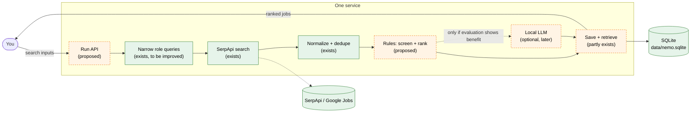

# Phase 1 architecture (short version, for review)

Status: **proposal; "Proposed" parts are not built.** Updated 2026-10-02. Older docs [02](02-scope.md) and [03](03-architecture.md) describe an earlier, stricter design (verified posting dates, Tavily first); this page replaces them where they differ. Background: [07 provider findings](07-search-provider-findings.md), [06 local model](06-local-model-findings.md).

## 1. Scope

Phase 1 is **one service and one SQLite database.** You give it search inputs. It finds jobs, screens and ranks them, and saves each job's description and application links. You read a ranked list.

A useful result: top jobs fit your target roles, each keeps its description and links, and exclusions and unsearched queries are visible.

Out of scope: résumé tailoring (Phase 2), applying, other providers, fallback. Only SerpApi is used. Phase 2 will read only what Phase 1 saves: description, links, provenance and the match assessment.

## 2. What exists today

`scripts/run_search.py` is a hand-run, synchronous script.

1. It builds a search plan from your roles, locations and `config/search_terms.json` (`src/nemo/queryplan.py`).
2. It sends them to **SerpApi** (Google Jobs and Google Search). Tavily is used only in probe scripts.
3. It keeps every Google Jobs result, with or without a LinkedIn link, removes duplicates, and saves them (`src/nemo/discovery.py`, `store.py`, `data/nemo.sqlite`, `runs/<id>/`).

**Where data comes from:** title, company, location and description come from *Google's listing*, not from LinkedIn, and each job records which site supplied the description. No code fetches a LinkedIn page. Dates are Google's claims. All application options are kept; an employer/ATS link is preferred when established; job boards are labelled as such and uncertain links as unknown. LinkedIn links are consistency-checked against the listing, not verified; a clearly mismatched one is rejected and the job is kept without it. Jobs with no application link and no Google job ID are skipped and counted.

**Gaps:** screening is a separate script (below), not part of the run; a crashed run loses work; the last run completed only 4 searches.

## 3. Proposed flow

Green exists; orange dashed is proposed.

**Queries (exists):** `config/search_terms.json` groups your target roles into families (backend, devops/platform, testing, AI) with natural aliases ("SDE I", "Associate DevOps Engineer", "SDET I", "Junior AI Engineer"), a few "0-2 years" combinations, and plain-role searches, because suitable jobs don't always say junior. Searches rotate across families and locations. Target cities are Bengaluru and Hyderabad (`default_locations`; Visakhapatnam is no longer searched). The first four searches are pinned as a small benchmark. A capped run always executes the same first searches, so `--offset N` runs the next batch. `--dry-run` shows the order, request-count cap and which searches fit. Search terms cannot guarantee a description meets your experience limit, so screening checks each one.

**Experience rule (exists):** a job is excluded when its *required* minimum is above 2 years. A range counts by its minimum (2-4 is borderline, 3-5 is excluded). Exactly 2 years is borderline. Gaps are shown separately against your 14 full-time and 21 total months. Preferred years never exclude. If a posting also states another route ("fresh graduates … encouraged"), both statements are kept and the job is marked for review, not excluded. An unstated requirement stays eligible and flagged. Missing software keywords alone never exclude a QA role. Years are read from applicant sentences only (company and CEO figures are ignored); mixed-level titles ("SDE I, II, III") go to review. Passing the filters is not a strong match: each job gets a discipline (frontend or data-science SDE I jobs are adjacent), a match level (strong / possible / adjacent / weak) and a description-length flag (length is not proof of completeness; short descriptions are never strong). Application links are checked for structure only, not fetched. Reported age is shown, not used to exclude.

**Relevance (exists as `scripts/screen_results.py`, rules only):** a job is excluded only for a clear violation of a dealbreaker. Preferences change ranking only. If a posting doesn't state a requirement, it stays **unknown**, and unknowns are not penalised automatically. Each job shows **fit** (how well it matches) and **confidence** (how much the description actually says) separately. The local LLM is added only if evaluation (§6) shows rules miss something it catches.

**Visibility (a goal, not a guarantee):** excluded and skipped jobs are counted, excluded jobs keep their reason, and each run reports searches completed versus planned. Coverage stays partial.

## 4. Inputs and outputs (proposed)

- **Input:** roles, locations, look-back, and a **maximum number of searches** (a request-count cap, configurable). The existing dollar guard (`src/nemo/budget.py`) stays as a safety net, but its per-search price is an assumption, not verified billing.
- **Run API, two calls:** start a run (returns a run ID, works in the background), and fetch a run (status, searches completed/planned, ranked jobs). HTTP framework choice is deferred.
- **Each job:** title, company, location, fit, confidence, reasons, flags, description and its source, all application links, LinkedIn link if any, retrieval time.

## 5. Minimum database

| Table | Holds | Status |
|---|---|---|
| `runs`, `run_queries` | run status, each search and outcome | exists; add `running` state and crash recovery |
| `jobs` | one row per job. Key: LinkedIn job ID when a consistency-checked link exists, else a hash of the application URL (job-id query parameters kept, known tracking parameters removed), else Google's job ID; never title alone. Description, its source, links, first/last seen | exists |
| `job_links` | every application link, labelled | proposed (today stored inside the job record) |
| `run_jobs` | jobs found per run, raw listing | exists |
| `assessments` | per run and job: fit, confidence, reasons, exclusions, rule version | proposed |

A repeat sighting updates the one `jobs` row and adds a `run_jobs` row, so history is kept. Jobs are never merged by title alone.

## 6. Security and evaluation

- Keys only in `.env`/environment, never in git, logs or the database; `.env` and the database readable only by you; localhost only; bound query parameters; logs hold IDs and counts, not descriptions. Descriptions are untrusted text for any future LLM. Back up by copying the database file.
- **Evaluation:** [`runs/review-batch.md`](../../runs/review-batch.md) (local, gitignored) holds 10 deduplicated saved jobs. You label each relevant / maybe / not relevant. We then check whether the rules keep your "relevant" jobs, rank them high, and exclude none by mistake.

## 7. Next steps

1. Run the four-search benchmark and review the returned jobs.
2. Add `assessments`, run state and recovery.
3. Expose the two-call service.
4. One end-to-end run, reviewed together.

## 8. Needed from you

1. **Target roles and relevant experience** (to narrow queries and define fit).
2. **Acceptable locations and work arrangements, and genuine dealbreakers.**
